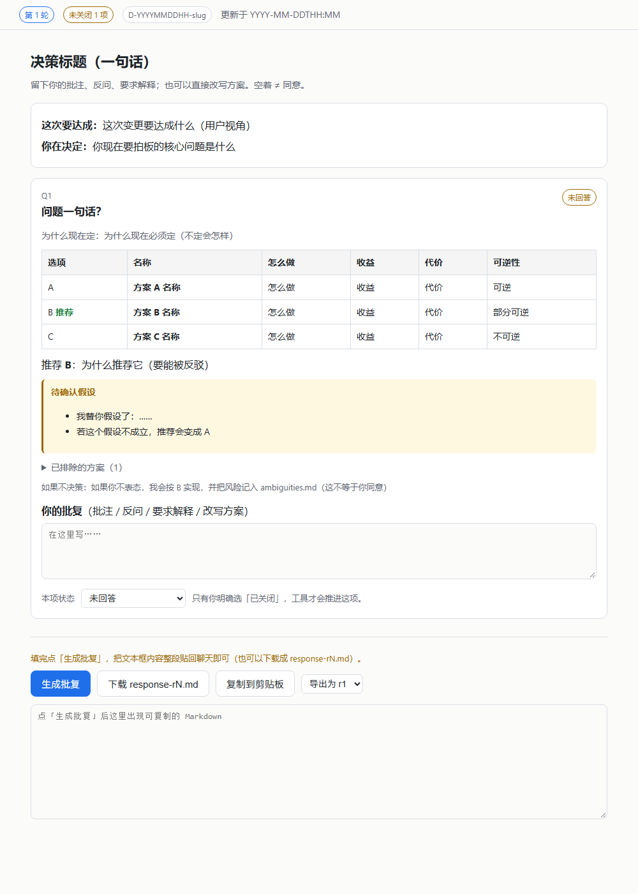
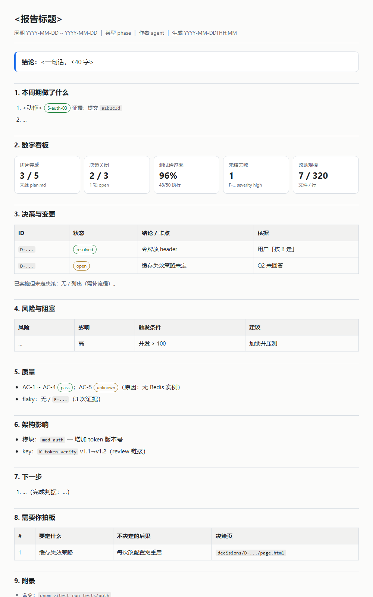
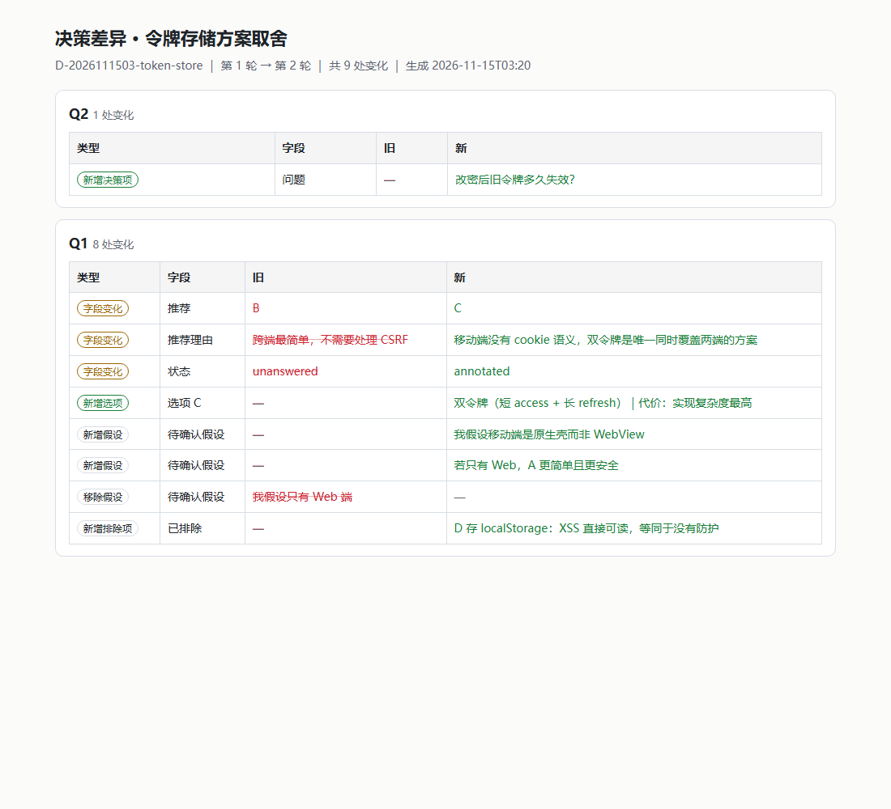

# `.gen` 体系 · 通用 Vibecoding 过程规范（中文版 v4.3.0）

> 一句话：把"和 AI 一起做大型项目"里最容易丢的东西——**对齐过的决策、验证过的证据、可理解的架构、追得回的测试历史**——变成仓库里一套固定的目录和 12 个可执行 skill。
>
> 交付物：根 `AGENTS.md`（制度）+ `.gen/`（状态与规程）。复制到任何项目即可用，与语言/框架无关。

---

## 0. 先看结论（如果你只读三句）

1. **目录叫 `.gen`**：所有过程产物都是"生成物"，有生成者、有轮次、有依据；它不是 `.project` 那种"工程文件"语义。
2. **两条横切规则**撑起整套：**决策多轮交互、关闭才放行**；**md/html 按复杂度判定，默认 md**。
3. **12 个 skill 挂在一条环上**：`intake → analyze → plan → decision-gate → implement → validate → repair → document → advance`，每个 skill 都有触发、步骤、交付判定和反模式。

---

## 1. 为什么叫 `.gen`，不用 `.project`

| | `.project` | `.gen`（本方案） |
|---|---|---|
| 语义 | "项目工程文件"——容易被当成 IDE 元数据、构建配置 | "生成的过程记录"——每份文件都是某次会话的产物，有 `created`、`author`、`round` |
| 心理预期 | 静态、可手写 | 动态、由工具写、人只批注 |
| 冲突面 | 和 `.idea`、`.vs`、`project.godot` 等易混 | 无常见同名词 |
| 和你已有习惯 | 你已经倾向于 `.gen` | ✅ |

文件名 `gen` 同时兼容三种读法：**gen**eration（生成）、**gen**ealogy（谱系，能追溯）、**gen**uine（真实性，有证据）。这三件事恰好就是这套体系要保证的。

---

## 2. 层次：为什么顺序必须是这样

你的原始 5 条要求其实是混在一起的（决策、目录、报告、测试、架构），另外还问了两个问题（有没有现成规范、这些要求是否合理）。理顺之后是六层，**上层不成立时下层做了也白做**：

```text
L0 宪法        根 AGENTS.md —— 不可协商的规则（闸门、单一真源、不谎报）
L1 状态栈      workflow/state/ —— 我们在哪、做到哪、还欠什么
L2 对齐与规格  decisions/ + specs/ —— 到底要做什么（多轮、可追溯）
L3 实施与验证  implement/validate/repair + tests/ —— 做对了没有（证据）
L4 沉淀        reports/ + architecture/ + key/ —— 让别人和未来的你能接手
L5 演进        VERSION + skill 自身修订 —— 体系也要能被改（走 L3 流程）
```

**为什么决策在规格之前、报告在最后**：决策关闭后才允许写实现，实现验证完才值得写报告；报告是"结果"，不是"过程"。如果先要求出报告，就会倒逼出"为了填表而做事"。

---

## 3. 一个需求走完整条路（示例）

```text
你：登录态要能主动失效，改密后立刻踢掉旧设备

① continuation-planner  读状态栈 → "上次停在 S-auth-02，有 1 个 open 决策"
② analyze               证据：现在 token 无版本号（verify.ts:42）→ 验收标准 AC-1..AC-3
③ plan                  拆 3 片：加字段/改签发/改校验 + 回滚方式 + 停止规则
④ decision-page         Q1 token 版本号存哪（DB/Redis/签名里）→ page.html
   你：逐项批注 → 导出 → 贴回
   工具：逐项回应 → 第 2 轮页面 → 你确认 → resolved
⑤ implement             闸门检查通过 → 只改 touch list 内 5 个文件 → tsc/eslint 真跑
⑥ validate              AC-1 pass / AC-2 unknown（无 Redis）/ AC-3 pass
⑦ repair                AC-2 环境补齐后跑，失败 → 复现 → 根因 → 回归测试
⑧ test-ledger           每次执行一行；失败建 F-... 档案
⑨ arch-sync             mod-auth 更新 + K-token-verify v1.1→v1.2 + human 层重渲染
⑩ periodic-report       2026111502-登录态主动失效阶段评审.html
```

---

## 4. 目录全图（一眼版）

```text
<repo>/
├── AGENTS.md                 ← 制度（复制根目录）
└── .gen/
    ├── AGENTS.md             目录契约：命名/时间戳/frontmatter/状态枚举
    ├── VERSION               体系版本
    ├── skills/               12 个 SKILL.md（Agent Skills 规范）
    ├── templates/            所有模板（唯一真源）
    ├── workflow/state/       状态栈 5 件套（快照/当前阶段/流水/疑问/完成定义）
    ├── workflow/plans/       切片计划（带版本）
    ├── workflow/handoffs/    交接记录
    ├── decisions/            INDEX.md + D-*/（page.html + thread.md + response-rN.md）
    ├── specs/<feature>/      spec.md + revisions/ + plan.md + decisions.md
    ├── reports/              YYYYMMDDHH-<标题>.md|.html + INDEX.md + archive/
    ├── tests/                LEDGER.md + history/ + failures/ + fixtures/ + runs/(ignored) + matrix.md
    └── architecture/
        ├── agent/            单一真源：ARCHITECTURE/modules/contracts/flows/key/adr/snapshots
        └── human/            生成物：ARCHITECTURE/KEY/GLOSSARY/KNOWN-ISSUES/annotations
```

**只记一条**：`decisions/` 和 `architecture/` 是追查依据，任何情况下都不能整体 gitignore；`tests/runs/` 是唯一默认不入库的大件。

---

## 5. 文件强规范（摘要，全文在 `.gen/AGENTS.md`）

| 规则 | 内容 | 为什么 |
|---|---|---|
| 时间戳 | 文件名 `YYYYMMDDHH`，同小时多份加两位分钟 `YYYYMMDDHHmm`；正文用 RFC 3339 带时区 | 排序即历史；跨时区不歧义 |
| 命名 | `<前缀>-<TS>-<slug>`，slug 全小写 ASCII kebab-case；**只有报告标题允许中文** | 工具 grep/排序稳定，人能读标题 |
| frontmatter | `id/kind/title/created/status` 必填，`kind` 是封闭枚举 | 机器可索引，脚本可校验 |
| 状态 | 决策 `open/resolved/blocked/superseded/waived`；测试 `pass/fail/flaky/skipped/blocked`；… | 禁止"基本完成"这类无法判定的词 |
| 追加 | `thread/progress/LEDGER/CHANGELOG` 只追加；写错追加更正行 | 历史不可篡改，追查才可信 |
| 冻结 | `snapshots/`、`final` 报告永不修改 | 阶段结论是时间点事实 |
| 禁止 | 仓库根散放 `NOTES/TODO/临时/report-final-v2` | 过程文件会污染代码仓 |

---

## 6. 两条横切规则（真正的核心）

### 规则 A：决策是多轮对话，不是登记表

- 一个决策一个目录，`thread.md` 是权威记录，`page.html` 是当前界面。
- 每轮工具必须**逐项回应**：解释、回答反问、修订方案、提出新问题（每轮新增 ≤3 个，防发散）。
- 关闭只由你明确表态触发；工具不得单方面宣布；`thread.md` 必须写"依据：<你的原话>"。
- **未关闭 = 不放行实现**。闸门写在两处：根 `AGENTS.md` R1 和 `implement` 第 0 步。
- 给"沉默"留了代价但不给默认同意：每项必须写"若不决策的默认行为"，你仍可 `waived`，但风险入档。

### 规则 B：md 还是 html，由复杂度决定，不由目录决定

| 判据 | md | html |
|---|---|---|
| 要不要你动手（选择/批注/回传） | 否 | 是 |
| 是否并排对比 ≥3 方案 | 否 | 是 |
| 一屏能否扫完 | 能 | 不能且需分区 |
| 更新方式 | 追加/小改 | 整体快照 |

唯一预设：**决策页恒为 html**（它的本质是交互）。选 html 必须在首行写理由；同一内容不要 md/html 双份手工维护。

### 两张模板的实际渲染

决策交互页（逐项批注 + 状态自选 + 导出批复）：



报告 HTML（数字看板 + 决策表 + 待拍板项）：



---

## 7. 与业内既有规范的关系（你的第 7 问）

### 已经很成熟、本方案直接复用的

| 规范 / 工具 | 它解决什么 | 本方案怎么用 |
|---|---|---|
| [AGENTS.md](https://agents.md/)（开放格式，Linux Foundation 下 AAIF 托管，6 万+ 仓库使用，Codex/Cursor/Jules/Aider 等都认） | 给 agent 一个可预测的指令位置；嵌套就近生效 | 仓库根 `AGENTS.md` 写制度；`.gen/AGENTS.md` 写目录契约 |
| [Agent Skills 规范](https://agentskills.io/specification)（`SKILL.md` + frontmatter + 渐进披露） | 把任务知识打包成可复用、可懒加载的单元 | 12 个 skill 全部按此格式，`name` = 目录名，正文 <500 行 |
| [GitHub Spec Kit](https://github.github.io/spec-kit/)（Specify → Plan → Tasks → Implement → Converge，含 constitution/checklist，43 种 agent 集成） | 需求到实现的阶段化与模板化 | `analyze/plan/implement` 的骨架与它同构；本方案补上"决策闸门"和"过程留痕目录" |
| Kiro 的 spec 三段式（requirements/design/tasks）+ steering | 结构化需求与设计 | `specs/<feature>/spec.md + plan.md` 对应其前两段 |
| ADR（Nygard）/ MADR | 记录架构决策及后果 | `architecture/agent/adr/`，只写摘要并链回 `thread.md` |
| [C4 model](https://c4model.com/) / arc42 / Structurizr | 分层描述架构；Structurizr 的"模型生成视图" | `architecture/` 双层的理论依据：**agent 层是模型，human 层是视图** |
| [Diátaxis](https://diataxis.fr/) | 按读者目的分类文档 | 解释为什么"机器读"与"人读"必须分开写，而不是一份文档两种语气 |
| Keep a Changelog / SemVer / Conventional Commits | 变更可读、版本可预期 | `key/CHANGELOG.md` 行格式；`VERSION` 用 SemVer；提交信息建议（不强制工具链） |
| RFC 2119（MUST/SHOULD） | 区分硬约束与建议 | `AGENTS.md` 用"铁律 R1–R10"表达 MUST，skill 里用"建议/默认"表达 SHOULD |
| 无责事故复盘模板（SRE postmortem） | 事故报告结构 | `periodic-report` 的 `incident` 类型 |

### 半有、需要自己拼的

| 能力 | 现状 | 本方案的增量 |
|---|---|---|
| 需求澄清 | Spec Kit 有 `/clarify`（一次问若干问题写回 spec）；Kiro 有需求迭代 | **多轮 HTML 页面 + 逐项回应义务 + 目录化线程 + 硬闸门**（现有工具都没有"关闭才放行"这条） |
| 计划可视化 | 各工具 plan mode 只在聊天里 | 落盘成 `plans/<TS>-<phase>.md`，带停止修复规则 |
| 测试历史 | CI 有 JUnit XML / 各平台历史，但不在仓库 | **append-only 月卷 + 失败档案 + 环境矩阵**，可 grep 追溯"何时开始不稳" |
| 架构文档 | C4/arc42/Structurizr 都是给人看的 | **agent 层（源）+ human 层（渲染）+ 批注回路**，解决"AI 写的架构你看不懂还不能改" |
| 关键实现守护 | ATAM、fitness functions、evolving architecture 有方法论 | **key registry + 七问发现 + 影响×不可逆分级 + 变更史 + 人签字** |

### 基本没有现成方案的

- **决策的"多轮往复 + 关闭才放行 + append-only 线程"**：这是你这套体系最有价值的原创点。
- **过程目录的强命名与状态枚举**：业内多是"建议"，很少有强制 schema。
- **双架构 + 批注回执**：把"你看不懂"变成一条可闭环的工单，而不是抱怨。

> 关于 "Codex 自带什么"：Codex 原生吃 `AGENTS.md`（OpenAI 仓库自己就有 88 个），另有自定义 prompt 与 `config.toml` 配置、沙箱与审批模式；Agent Skills 是跨客户端开放格式，Claude Code 等直接读 skills 目录。所以本方案**不绑定任何一家**：`AGENTS.md` 保证"任何工具都读到制度"，`SKILL.md` 保证"支持规范的客户端能自动加载规程"。

---

## 8. 对你 5 条要求的逐条评估（拆成 7 个评估点）

| # | 你的要求 | 判断 | 理由 | 我做的收紧 |
|---|---|---|---|---|
| 1 | 重大决策生成可交互 HTML，多轮追问/解释/修订，读完批复再继续 | **合理且是核心** | 文本聊天里"对齐"最容易丢；页面能把选项、代价、假设摊开 | 加了"每轮新增 ≤3 问"、"若不决策的默认行为"、"关闭依据必须是你的原话"、`waived` 通道；否则会无限循环 |
| 2 | 一个固定文件夹放功能性与交互性产物，要具体命名与层级 | **合理** | 没有固定位置，产物就会散落在根目录 | 用 `.gen`；给出 3 类 30+ 条命名规则与状态枚举；模板集中在 `templates/` |
| 3 | 定期报告，`数字年月日时 + 标题`，复杂用 html | **合理** | 时间戳前缀让目录天然按时序排；html 适合看板 | 加了"无实质变更不写报告"、"十节固定结构"、"报告只读、要拍板去开决策页"；否则报告会变成负担 |
| 4 | 测试专用目录 + 全程记录 + 可不进 git + 可追查 | **非常合理** | 失败历史是最便宜的资产 | `runs/` 不入库、`failures/` 与证据入库；9 列台账；`flaky` 需 3 次证据；月卷防止文件无限长 |
| 5 | 两套架构（工具自清洗 / 你能看懂），feature 变更自动更新，human 版可批注 | **合理，但这是最容易腐化的一环** | 两份文档必然漂移 | **单一真源**：agent 层是源，human 层是渲染物、禁止手改；批注用 `@note` + `@resolved` 回执；drift check 进同步报告；human 层写作有"五句话/首句结论/禁堆术语"硬规则 |
| 6 | 不同技术栈无所谓，但**找出 key 的能力**最关键 | **完全正确** | 换框架不重写的那段逻辑才是产品本体 | `key-guard`：七问发现 + 影响×不可逆分级 + 可断言不变量 + 变更史 + 人签字；明确"key ≤15 个，否则失效" |
| 7 | 理清顺序层次；问有没有现成规范；评估合理性 | — | — | 见 §2、§7、§8；现成规范比你预想的多，但"决策闸门 + 过程目录"这块基本是空白 |

### 我认为需要提醒你的 5 个风险

| 风险 | 表现 | 已在方案中的对策 | 你还需要做的 |
|---|---|---|---|
| **仪式过重** | 写文档时间 > 写代码，最后放弃 | L1/L2/L3 分级；"无变更不写报告"；模板填空化 | 前两周只启用 `decision-page + implement + tests`，其余延后 |
| **HTML 回写断链** | 浏览器不能写磁盘，你导出、粘贴，中间丢了 | 导出 Markdown + 下载 + 剪贴板三通道；粘贴回聊天由工具落盘 | 若嫌麻烦，二期做一个本地 `gen serve`（静态服务 + POST 落盘），但**不要一开始就做** |
| **双架构漂移** | human 层越改越旧，最后没人看 | human 层是生成物，改正文会被覆盖；批注才是入口 | 每次 `arch-sync` 后花 2 分钟读 human 层，读不懂就写 `@note`（这是体系运转的燃料） |
| **闸门误伤/拖延** | 每个小改动都被一个无关决策拦住 | 闸门只拦"与当前切片相关"的决策，匹配依据必须写明；`waived` 通道 | 定期清 `decisions/INDEX.md`，别让 `open` 堆积超过 5 个 |
| **决策发散** | 一轮提 10 个问题，你不想看了 | 每轮新增 ≤3；超了就拆新决策目录 | 一页只放 1–4 项；宁可多开几个小页面 |

### 这套体系"故意没做"的部分（避免过度设计）

- **不绑定技术栈**：没有 lint 规则、CI 模板、语言特定的目录约定——那属于各项目自己的 `AGENTS.md`。
- **不做实时多人协作**：不需要数据库、不需要服务端；`file://` 打开即可用。
- **不强制工时/成本管理**：那是项目管理工具的事，写进 `.gen` 只会让文件变成废纸。
- **不做自动改名迁移**：v4 之前的文件要不要批量改名，交给一次 `decision-page` 决定。

---

## 9. 怎么落地（两周够用）

### Day 0（30 分钟）

1. 复制根 `AGENTS.md` 和整个 `.gen/` 到你的仓库。
2. 在 `.gen/skills/` 里挑 3 个先用：`decision-page`、`implement`、`test-ledger`。
3. 对 AI 说：**"读 AGENTS.md，然后按 gen-init 初始化"**。

### Week 1（只练一个习惯）

- 每次要写代码前，先让工具问："这个需求有模糊点吗？有就开决策页。"
- 每天结束时 `progress.md` 追加一行（30 秒）。
- 目标：跑通 **1 个决策的 2 轮往复 + 1 次完整验证**。别的都先不用。

### Week 2（补齐沉淀）

- 第一次 `arch-sync`：让工具生成 human 层，**你读一遍并至少写 3 条 `@note`**（这一步决定体系是否真的对你有用）。
- 第一次 `test-ledger` 分卷：确认 grep 能追溯。
- 第一次 `periodic-report`：只写 md 也行，重点是"需要你拍板的事"这一节能写出来。

### Week 3+（按需）

`key-guard`（先只登记候选，不急着定级）→ `repair` 规范化 → 决策页从 md 改 html 的边界。

---

## 10. 交付清单

| 路径 | 内容 |
|---|---|
| [AGENTS.md](AGENTS.md) | 项目宪法：10 条铁律、进程、分级、两条横切规则、DoD |
| [.gen/AGENTS.md](.gen/AGENTS.md) | 目录契约：命名、时间戳、frontmatter、状态枚举、追加/冻结/归档 |
| [.gen/skills/README.md](.gen/skills/README.md) | 12 个 skill 的索引、安装、依赖图 |
| `.gen/skills/<name>/SKILL.md` × 12 | 每个：触发 / 不触发 / 步骤 / 交付判定 / 反模式 / 模板 |
| `.gen/templates/decision/page.html` | **可直接用的多轮决策交互页**（无预选、逐项输入、导出/下载/复制、暗色、打印、历史轮） |
| `.gen/templates/decision/{thread,response,INDEX}.md` | 线程、批复、看板 |
| `.gen/templates/state/*.md` × 5 | 状态栈五件套 |
| `.gen/templates/spec/{spec,revision,plan}.md` | 规格、修订、切片计划 |
| `.gen/templates/report/{report.md,report.html}` | 报告双格式（html 带数字看板） |
| `.gen/templates/test/{ledger,failure,matrix}.md` | 台账、失败档案、环境矩阵 |
| `.gen/templates/architecture/*.md` | agent 总图、模块页、human 版、key 登记/变更史/评审、ADR |
| `.gen/templates/{handoff.md,gitignore.template}` | 交接、忽略规则 |
| `.gen/templates/ci/gen-lint.yml` | CI 模板：每次 push 跑 lint + 闸门 |
| [.gen/scripts/gen.mjs](.gen/scripts/gen.mjs) | **零依赖工具链**：lint / status / serve / new / init / demo / test / key-check / install / report / decision-diff |
| [.gen/scripts/gen.test.mjs](.gen/scripts/gen.test.mjs) | 工具自测：56 个用例（node:test，无第三方依赖） |
| [.gen/scripts/README.md](.gen/scripts/README.md) | CLI 用法、检查项清单、测试覆盖、安全边界 |
| [.gen/scripts/new-artifact.ps1](.gen/scripts/new-artifact.ps1) | PowerShell 兼容包装（实际调用 gen.mjs） |

---

## 11. 参考

- AGENTS.md 开放格式：<https://agents.md/>
- Agent Skills 规范：<https://agentskills.io/specification>
- GitHub Spec Kit：<https://github.github.io/spec-kit/>
- C4 model：<https://c4model.com/> · Diátaxis：<https://diataxis.fr/>
- ADR（Michael Nygard）：<https://cognitect.com/blog/2011/11/15/documenting-architecture-decisions>
- Keep a Changelog：<https://keepachangelog.com/> · SemVer：<https://semver.org/>
- Agentic AI Foundation（AGENTS.md 治理）：<https://aaif.io/>

---

## 12. 工具链（v4.3.0）

不再只是"文档约定"：`.gen/scripts/gen.mjs` 把确定性的部分变成了可执行检查。零依赖，Node ≥ 16，跨平台，可在任意子目录跑。

```bash
node .gen/scripts/gen.mjs lint      # 一致性校验（退出码 1 = 有错误）
node .gen/scripts/gen.mjs status    # 状态摘要 + 闸门结论（退出码 1 = 有未关闭决策）
node .gen/scripts/gen.mjs serve --decision D-2026111503-token-store   # 页面直存批复
node .gen/scripts/gen.mjs new decision --slug cache-strategy --title "缓存策略"
node .gen/scripts/gen.mjs init --root <项目>    # 幂等初始化
node .gen/scripts/gen.mjs demo                  # 生成可跑示例，先看效果
node .gen/scripts/gen.mjs test                  # 工具自测（56 用例，~18s）
node .gen/scripts/gen.mjs key-check             # 提交前：有没有碰到 key
node .gen/scripts/gen.mjs report --title "第47周进展" --write   # 报告初稿
node .gen/scripts/gen.mjs decision-diff --decision D-2026111503-token-store
node .gen/scripts/gen.mjs install --target claude               # 装 skills 到客户端
```

`lint` 真正能抓到的（都已用注入缺陷验证过）：

| 码 | 抓什么 |
|---|---|
| E25 | 决策 `thread.md` 的 `id` 与目录名不一致（改名后最容易漏） |
| E32 | `status: resolved` 但「最终结论」还是占位内容——**这是"假关闭"的唯一可靠拦截** |
| E34 | `INDEX.md` 状态与 `thread.md` 不一致 |
| E26 | 文件名时间戳与 frontmatter `created` 不一致（手改时间 = 伪造历史） |
| E41 | 测试台账列数不是 9 列 |
| W20 | 文件里还留着 `YYYYMMDDHH` / `<...>` 占位符 |
| W51 | 人读架构缺 `generated_from`（可能是手改的） |
| W90 | `links` 指向不存在的 `D-`/`F-`/`R-` ID |

`serve` 解决了我上一轮标记的最大风险：浏览器不能写磁盘 → 现在页面检测到 `http://127.0.0.1` 就启用「保存到 .gen/」按钮，POST 后由服务端写 `response-rN.md`，粘贴断链消失。只绑回环、正则校验决策 ID、只允许写该目录的 `response-rN.md`、请求体 ≤2MB。

一个实现细节值得记下来：Windows 上源路径含中文时 `fs.cpSync` 会让 Node 直接崩（`0xC0000409`），脚本因此自己实现 `copyTree`（`readdir + copyFileSync`）。踩过一次，写进 [scripts/README](.gen/scripts/README.md) 了。

### 四个让规则"长出牙齿"的命令（v4.3.0）

| 命令 | 把哪条纸面规则变成可执行 |
|---|---|
| `key-check` | `key-guard` 的"变更必须人确认"：`git diff` ∩ `REGISTRY.md` 的 `path:start-end`，**按行号精确定位**；命中 critical/high 直接退出码 1。只改到区间外会提示但不算命中（避免误伤） |
| `install` | "skills 要能被客户端加载"：一条命令装到 `.claude/skills` / `.codex/skills` / `cursor` / 自定义目录，写 `.gen-install.json` 清单；**目标目录不是 gen 装的会拒绝覆盖**，Windows 用 junction 无需管理员 |
| `report` | `periodic-report` 的"数字必须来自文件"：从 INDEX/LEDGER/failures/progress 直接算，输出 `draft`，结论与风险留占位——数字对了不代表判断对了 |
| `decision-diff` | `decision-page` 的"逐项回应"要可验证：解析两轮页面的 JSON，输出**按项分组、左旧右新**的差异页 |



决策页数据因此从 JS 字面量改成 `<script id="gen-data">` 的 JSON 块——既是数据/展示分离，也让 diff 能可靠解析（不用 `eval`）。

### 测试（v4.3.0）

56 个用例全绿（`node --test`，零第三方依赖），每个用例自建临时项目、走真实模板初始化，跑完删除：

| 分组 | 断言什么 |
|---|---|
| frontmatter | 注释剥离、数组、嵌套、无 frontmatter、引号 |
| lint 基线 | 模板包与刚 init 的项目都 0 错误 |
| lint 负向 | **每条规则一个注入缺陷**：E20/E21/E23/E25/E26/E30/E32/E33/E34/E35/E41/E13/W20/W70/W90/E01；`--strict` 升级 |
| status | open → 退出码 1、全 resolved → 0、状态表解析 |
| new | 自动登记 INDEX、重名拒绝、md/html、五种产物落位 |
| init | 幂等、`--force` |
| demo | 示例项目 lint 通过 + status 报阻塞 |
| serve | 真起子进程 + 空闲端口 + `fetch`：列表/页面/POST 落盘/非法 ID 400/空批复 400/404 |
| **key-check** | 真 git 仓库：区间命中 → 1、区间外 → 0、`--fail-on none`、`--files`、非 git → 3 |
| **install** | 12 skill + 清单、重复幂等、非 gen 目录拒绝/`--force`、`--link` |
| **report** | 数字正确、`--write` 登记 INDEX 且 lint 干净、`--json` |
| **decision-diff** | 新增项/推荐变化/选项字段变化、HTML 旧新对照、缺快照 → 1、demo 自带两轮可 diff |
| 回归 | `copyTree` 复制中文路径（cpSync 崩溃场景） |
| 技能包 | 12 个 skill 齐全、name 与目录一致、description 长度 |

累计被测试抓出的 bug：`thread.md` 的 `kind` 与枚举不符、`YYYYMM` 替换把占位 ID 变成 `202611DDHH`、init 后 INDEX 占位行被当成悬空决策（E35 误报）、status 的 JSON 缺状态表字段、`decision-diff` 因浅拷贝导致"选项未变化"的假阴性。这些正是"看着能跑"和"确实正确"的差距。

## 13. 还剩什么（优先序）

1. **drift check**：模块清单 ↔ 实际目录、`key_refs` ↔ REGISTRY 的自动比对（现在只有 `key-check` 的行号漂移提示）。
2. **install 过期检测**：读 `.gen-install.json` 的版本与 `VERSION` 比对，提示"客户端里的 skill 已过期"。
3. **pre-commit 钩子**：把 `lint` + `key-check` 装成 git hook（现在只有 CI 模板，仍需手动跑）。
4. **报告 HTML 看板**：`gen report` 目前只出 md 初稿；html 看板还是模板手工填。
5. **决策页内嵌 diff 面板**：现在差异要跑 `decision-diff` 生成独立页；理想是第 N 轮页面顶部直接显示"本轮变了什么"。
6. **skill 版本迁移**：`VERSION` 升版时给出字段/文件名迁移脚本。

## 14. 变更记录

| 版本 | 变更 | 破坏性 |
|---|---|---|
| 4.3.1 | 疑问表模板不再放假数据（示例移入代码块，其中一条还断言了错误的 Node 版本）；`gen.mjs` 新增 `appendTableRow()`，`demo` 改为往表尾追加行而不是替换示例行 | 无（模板里的示例行本就不是数据） |
| 4.3.0 | 修 CI 模板 `paths` 过滤导致 key-check 永不触发；修模板示例行被 `status` 当成真实数据（新项目误报"1 次 fail"）；宪法补齐 `waived` 状态并统一闸门口径（`resolved`/`waived` 均放行）；决策项状态统一为 `unanswered`；报告结构统一为十节（模板 / 工具 / skill 三处对齐）；`.gen/AGENTS.md` 状态枚举表补全（spec/adr/snapshot/ledger/state）；`init` 补建 `decisions/archive/`；`install` 改为按同名冲突判定（全局目录不再被一律拒绝）；12 个 skill 补齐"触发/步骤/交付判定"五段结构 | 决策项状态值由 `open` 改为 `unanswered`（旧页面数据块需改一次）；`report` 的 frontmatter 新增 `report_type` 实参传递、`--type` 现在会校验；报告章节号由 9 节变 10 节（"一句话结论"升为第 1 节） |
| 4.2.0 | 新增 `key-check`（git∩REGISTRY，命中即失败）、`install`（skills 分发）、`report`（看板初稿）、`decision-diff`（轮次差异页）；决策页数据改为 JSON 数据块；测试 40→56 | 决策页数据从 JS 字面量改为 `<script id="gen-data">` JSON；旧页面需转换一次（`fillPageData` 可用） |
| 4.1.1 | 新增 `gen test` 与 `gen.test.mjs`（40 用例）；修 4 个由测试暴露的缺陷；CI 模板加自测步骤 | 无 |
| 4.1.0 | 新增工具链 `gen.mjs`（lint/status/serve/new/init/demo）；决策页支持 localhost 直存；`kind` 增 `review`；`thread.md` 改为 `kind: thread` | 旧 `thread.md` 的 `kind: decision` 仍被接受（`KINDS` 两者都在），无需迁移 |
| 4.0.0 | 初版：`AGENTS.md` + `.gen/` 目录契约 + 12 skill + 模板 | — |

**升级方式**：把新的 `.gen/scripts/`、`.gen/templates/`、`.gen/AGENTS.md`、根 `AGENTS.md` 覆盖过去即可；运行 `node .gen/scripts/gen.mjs lint` 确认无新增 error。`VERSION` 只在目录树/命名/头部字段/状态枚举变化时才升次版本（见 `.gen/AGENTS.md` §10）。

